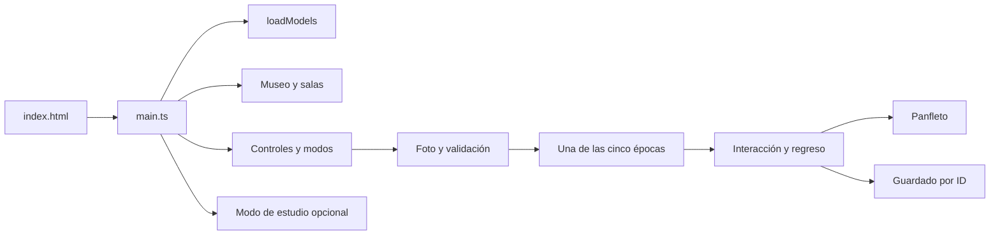

# Codemap del museo

Guía breve del código actual. Stack: **Three.js + TypeScript + Vite**, sin backend.
Egipto, Roma, Medieval, Japón y Luna tienen viajes jugables.

## Estructura

```text
index.html                DOM, menú y entrada de Vite
src/
  main.ts                 Arranque, render y coordinación del recorrido
  style.css               Estilos de la interfaz
  game/                   Mecánicas y datos del jugador
  museum/                 Patio, edificio, hall y circuito de salas
  worlds/                 Exhibiciones y mundos históricos
  rendering/              Modelos, geometría y utilidades visuales compartidas
  study/                  Escena de inspección visual (?view=far|mid|near)
public/assets/kenney/      Modelos, texturas, manifiesto y licencias CC0
docs/                    Guías vigentes, histórico y capturas
```

`node_modules/` y `dist/` son generados y están ignorados por Git.

## Dónde cambiar cada cosa

| Tema | Archivos principales |
| --- | --- |
| Inicio, cambio de mundo, bucle de render | [main.ts](../src/main.ts) |
| IDs, disponibilidad y orden de las cinco épocas | [game/catalog.ts](../src/game/catalog.ts): `areaOrder` es la fuente única del orden |
| Movimiento, colisiones, Pointer Lock, modos y pausa | [game/player.ts](../src/game/player.ts); contrato de límites en [collision.ts](../src/game/collision.ts) |
| Captura, encuadre, oclusión, Polaroid y disparo | [game/photo.ts](../src/game/photo.ts) |
| Panfleto 3D, mapa y recuerdos | [game/pamphlet.ts](../src/game/pamphlet.ts); manos y capa visual en [held.ts](../src/game/held.ts) |
| Guardado por ID y reinicio | [game/progress.ts](../src/game/progress.ts), clave `museo-del-tiempo:v1` |
| Transiciones y ayuda tras 20 segundos | [game/timeTransition.ts](../src/game/timeTransition.ts), [help.ts](../src/game/help.ts) |
| Composición del museo, fachada y acceso | [museum/museum.ts](../src/museum/museum.ts) |
| Planta, posiciones, puertas y luces de salas | [museum/museumLayout.ts](../src/museum/museumLayout.ts), [gallery.ts](../src/museum/gallery.ts) |
| Patio, casas, andén y tren | [museum/courtyard.ts](../src/museum/courtyard.ts); jardines y pirámide en `museum.ts` |
| Interior del hall y guardia | [museum/hall.ts](../src/museum/hall.ts), [guard.ts](../src/museum/guard.ts) |
| Acabados, pedestales y focos compartidos | [museum/exhibition.ts](../src/museum/exhibition.ts) |
| Contenido de Egipto, Roma, Medieval, Japón y Luna, incluida cada exhibición | [worlds/egypt.ts](../src/worlds/egypt.ts), [rome.ts](../src/worlds/rome.ts), [medieval.ts](../src/worlds/medieval.ts), [japan.ts](../src/worlds/japan.ts), [moon.ts](../src/worlds/moon.ts) |
| Contrato `HistoricalWorld` y liberación de recursos | [worlds/history.ts](../src/worlds/history.ts) |
| Carga de modelos y materiales toon | [rendering/assets.ts](../src/rendering/assets.ts), [visual.ts](../src/rendering/visual.ts) |
| Cielo, agrupación estática y casco compartido | [rendering/sky.ts](../src/rendering/sky.ts), [staticMeshes.ts](../src/rendering/staticMeshes.ts), [helmet.ts](../src/rendering/helmet.ts) |
| Máscara Oni, katanas, torii, techos y cerezos | [rendering/japanese.ts](../src/rendering/japanese.ts) |
| Nave, astronautas, cielo lunar y visor | [rendering/lunar.ts](../src/rendering/lunar.ts), [game/spaceHelmet.ts](../src/game/spaceHelmet.ts); subida y ascenso en `worlds/moon.ts` |
| Escena de demostración independiente | [study/studyScene.ts](../src/study/studyScene.ts) |

## Flujo principal



`main.ts` coordina el ciclo; `museum.ts` compone el edificio y las exhibiciones.
Los mundos reutilizan fotografía, controles, transición, ayuda y persistencia.
Los imports de tipos (`GalleryRoom`, `Collider`, `HistoricalWorld`) describen contratos,
sin cargar escenas de demostración ni crear ciclos de ejecución.

## Documentación y comprobación

- [Índice](README.md): guías vigentes e histórico.
- [Arquitectura](ARQUITECTURA.md): contratos, render y persistencia.
- [Assets Kenney](ASSETS_KENNEY.md): selección incorporada y procedencia.
- [Verificación](VERIFICACION.md): comandos, pruebas automatizadas y casos de regresión.
- [Archivo histórico](historico/README.md): planes, especificación original y revisiones de etapas.
