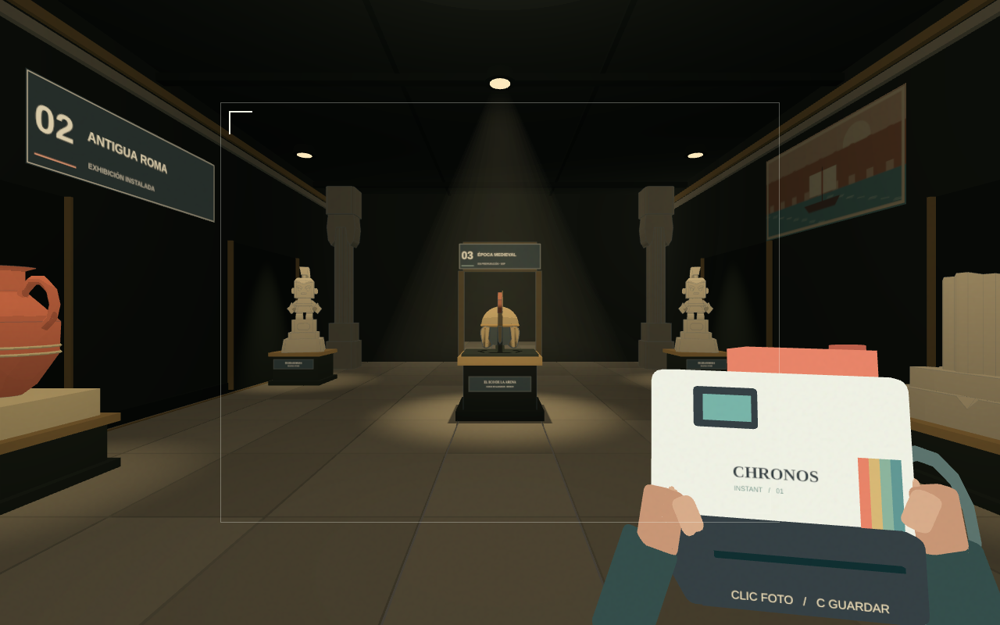
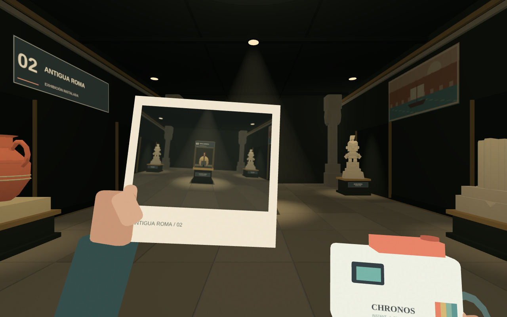
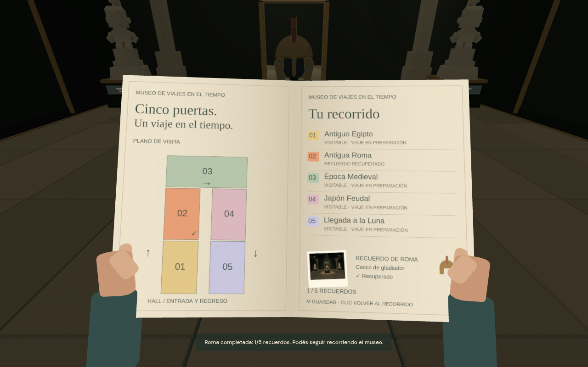

# Renovación visual con Kenney

> Registro histórico de esta revisión. Algunas capturas originales no están incluidas en el repositorio y se identifican como tales. Para la organización actual del código, ver el [codemap](CODEMAP.md).

## Reorganización del edificio y del hall

La planta del hall se alinea con las alas y la fachada: **24,9 unidades de ancho**, con límites y nivel de suelo compartidos en `src/museum/museumLayout.ts`. Roma conserva sus 10,8 × 16 unidades, la distribución de piezas, el casco al 55 % y sus cinco focos.

- Nave central con columnas y arcos alineados; dos pasillos laterales conducen directamente a las puertas. La última fila de columnas deja visibles los carteles desde el acceso.
- Vitrinas, esculturas, cuadros y bancos agrupados en los laterales. La zona posterior queda libre para distribuir la circulación.
- Bóveda y casetones conectados, cara interior de la fachada revestida con los mismos acabados, umbrales a nivel y pared posterior sin volúmenes duplicados.
- Mampostería, cornisas y cubiertas continuas para conectar el pabellón de entrada, el hall y ambas alas. La iluminación mantiene el esquema cálido y los focos sobre las piezas.
- Cartel de fin del recorrido frente al hall y orientación corregida de la señalización del ala de regreso.

Capturas: [hall desde la entrada](capturas/estructura-hall.png), [pasillo lateral](capturas/estructura-lateral.png), [mirada hacia el acceso](capturas/estructura-regreso.png) y [envolvente del edificio](capturas/estructura-exterior.png).

Verificado en Chrome: recorrido completo hasta el regreso con 1/10, foto válida e inválida, pausa durante la transición; tres pasillos longitudinales, cruce transversal, ambos muros del hall, detección de ubicación, acceso a Roma y cierre del retorno WIP. Se comprobaron techo y suelo en 63 posiciones y nueve puntos del umbral. Tipos y build correctos; continúa el aviso de Vite por el bundle principal de aproximadamente 714 kB. La medición de FPS con GPU real sigue pendiente.

Las secciones siguientes documentan las revisiones anteriores.

## Actualización del interior — referencia de sala romana

La referencia aportada se aplica al hall, la exhibición romana y la arquitectura común de las diez salas: paredes verde carbón, losas de piedra cálida, bases oscuras y molduras de bronce. La geometría sigue siendo low-poly y el sombreado de las piezas es toon. Las áreas WIP comparten los acabados, pero conservan sus puertas cerradas y no incorporan exhibiciones nuevas.

- **Hall:** bóveda opaca y cerrada, casetones oscuros, cuadros que reciben iluminación y vitrinas con focos y haces suaves. Se conservan bancos, esculturas, reloj e itinerario.
- **Roma:** techo de 5,4 m, columnas altas, esculturas y reliquias sobre pedestales, mural elevado y cartelería oscura. El casco de bronce queda centrado bajo un foco cálido con sombra; dos pasos laterales permiten rodearlo.
- **Luz:** la luz general disminuye gradualmente al atravesar el acceso. El ajuste se realiza antes de cada render, también al fotografiar. Los cinco focos de Roma acompañan el encendido de la puerta y se apagan al completar la sala. El patio conserva su iluminación diurna.
- **Coste:** las losas se dibujan con instancias; los haces son geometría transparente suave. Solo el foco central agrega un mapa de sombras de 512 × 512. Las luces generales de salas que no se abrieron permanecen fuera del render. No se agregaron modelos, texturas externas ni dependencias.

### Ampliación de las salas

Las diez salas pasan de **6,9 × 12,4 a 10,8 × 16 unidades**, aproximadamente el doble de superficie. Los centros de las alas pasan a x = ±7,05 y el cruce de la U se desplaza con el nuevo paso. Muros, techos, suelo, molduras y detección de sala usan las dimensiones de `galleryLayout`.

En Roma, las piezas y sus focos se distribuyen junto a las nuevas paredes laterales. El casco de la exhibición se reduce al **55 % de su tamaño anterior**, y su pedestal pasa de 1,8 × 1,6 a 1,25 × 1,12 unidades de base, con una colisión ajustada al nuevo volumen. Se conserva su identificación como artefacto fotografiable.

Capturas de las nuevas proporciones: desde la entrada — captura no incluida (`capturas/roma-ampliada-entrada.png`), cerca del pedestal — captura no incluida (`capturas/roma-ampliada-detalle.png`) y en el visor — captura no incluida (`capturas/roma-ampliada-visor.png`). Las capturas de atmósfera siguientes muestran la distribución anterior a esta ampliación.

Verificación de la ampliación: tipos y build correctos; recorrido completo hasta el regreso con 1/10; fotografía centrada, en borde y con oclusión parcial/total; ocho obstáculos, pedestal central, ambos pasos laterales, muros exteriores y 30 puntos de detección de sala. Reordenar Egipto al puesto 8 conserva su ID, número y posición en el panfleto.

### Capturas actuales

| Vista | Captura |
| --- | --- |
| Hall desde el acceso | Hall — captura no incluida (`capturas/atmosfera-hall-entrada.png`) |
| Vitrinas y pared lateral | Detalle del hall — captura no incluida (`capturas/atmosfera-hall-lateral.png`) |
| Sala de Roma | Exhibición — captura no incluida (`capturas/atmosfera-roma.png`) |
| Polaroid en el juego | Visor — captura no incluida (`capturas/atmosfera-visor.png`) |
| Foto y regreso | Panfleto 1/10 — captura no incluida (`capturas/atmosfera-completado.png`) |

### Verificación de esta actualización

- Tipos y compilación correctos. El bundle principal queda en aproximadamente 713 kB antes de gzip; continúa el aviso de Vite por superar 500 kB.
- Revisión en Chrome de hall, Roma, patio y visor a altura de jugador. Recorrido completo con guardia, panfleto, puerta 01, foto inválida, foto válida, viaje, recogida y regreso con 1/10; pausa y reanudación correctas.
- Casco centrado, en un borde y parcialmente tapado: aceptados. Fuera de cuadro y totalmente oculto: rechazados.
- Controlador real: ocho aproximaciones a bases/columnas, bloqueo del pedestal central y circulación por sus dos lados. Rayos verticales verifican techo en las diez salas y cuatro puntos del hall.
- Los cinco focos comienzan apagados, se encienden con la sala y vuelven a cero al completarla. Las otras nueve salas conservan sus luces generales deshabilitadas.

Estas pruebas usan Chrome con SwiftShader; la fluidez con GPU real sigue pendiente de medición. Las capturas y notas siguientes documentan revisiones anteriores.

Esta revisión mejora los escenarios y las herramientas existentes de las etapas 1 a 6. Se mantiene el recorrido jugable del [plan](Plan_de_desarrollo.md): inicio, guardia, panfleto, primera puerta, exhibición, fotografía, naumaquia y regreso con Roma completada. Egipto y las otras ocho épocas permanecen WIP.

## Actualización: jardines, portón y galería principal

- **Patio:** cuatro canteros con árboles en `x = ±11.1`, `z = 4.35 / 20.75`, entre los ejes de las puertas de las casas. Se rediseñaron con césped, flores y bancos hacia la plaza. Dos paños adicionales de pasto son transitables y tienen matas bajas instanciadas. El paso junto a las fachadas queda libre y se eliminaron los ocho carteles sobre las puertas.
- **Estación:** el cartel se conserva y se alinea con el punto de llegada. Debajo hay un portón de dos hojas con bisagras, manijas y pestillo, sin zócalo que atraviese el acceso. Al mirar atrás, termina de cerrarse durante 1,2 segundos y luego sale el tren. La abertura inicial es menor al diámetro del personaje; las colisiones acompañan las hojas y reservan el espacio del cierre para evitar atraparlo. La pausa también detiene esta animación.
- **Hall principal:** `src/museum/hall.ts` reúne el interior renovado: piso con guardas y medallón de reloj, paneles y molduras, columnas, arcos, techo con casetones y tragaluz rematado en sus extremos. Cuatro ilustraciones originales enmarcadas, cuatro vitrinas con piezas ajustadas al vidrio, esculturas, bancos y lámparas cálidas acompañan el paseo central. Las colisiones se obtienen del mobiliario colocado. Se reutilizan los modelos existentes; la selección sigue siendo de 31 GLB.

| Vista actual | Captura |
| --- | --- |
| Jardines del patio | Conjunto — captura no incluida (`capturas/renovacion-jardin.png`) |
| Accesos de las casas | Puertas despejadas y sin carteles — captura no incluida (`capturas/renovacion-puertas.png`) |
| Salida del andén | Portón con bisagras — captura no incluida (`capturas/renovacion-porton.png`) |
| Galería principal | Desde la entrada — captura no incluida (`capturas/renovacion-hall-entrada.png`) |
| Obras y esculturas | Lateral del hall — captura no incluida (`capturas/renovacion-hall-lateral.png`) |
| Techo y regreso | Mirando hacia el patio — captura no incluida (`capturas/renovacion-hall-regreso.png`) |
| Piso y vitrinas | Vista de detalle — captura no incluida (`capturas/renovacion-hall-piso.png`) |

Verificación en Chrome: cierre antes de la partida, pausa a mitad del cierre y posibilidad de alejarse del portón sin quedar atrapado. Se comprobaron las ocho aproximaciones a las puertas, ambos pasos laterales del patio, los dos paños de pasto, canteros, esquinas y colisiones de vitrinas, columnas, bancos y pedestales. El recorrido desde el andén hasta el guardia, panfleto, hall y Roma, con foto inválida, foto válida y regreso con 1/10, funciona con el nuevo interior. El hall visto desde la entrada registra aproximadamente 15.900 triángulos y 598 llamadas de dibujo; estas cifras no equivalen a FPS en hardware real.

Tipos, compilación y `git diff --check` correctos. La vista previa de producción carga los 31 modelos y cuatro texturas externas, inicia con Pointer Lock y abre el estudio visual sin errores. Vite mantiene el aviso por tamaño del bundle principal, de aproximadamente 708 kB antes de gzip.

## Revisión anterior: patio con estación

El jugador comienza en `(1, 26.3)`, a altura humana, del lado seguro del andén y mirando al museo. La locomotora y sus tres vagones quedan detrás. La primera mirada hacia las vías desde el patio inicia una partida con aceleración suave; continúa al mirar al frente y no se repite. Se detiene durante la pausa y al consultar el panfleto. El tren se oculta únicamente después de salir del alcance de la niebla desde toda la plaza.

Ocho casas adosadas, de uno o dos pisos, cierran los laterales. Muros cortos las conectan con la fachada; una baranda continua separa el andén de los rieles. Todos esos límites tienen colisiones, incluidas sus uniones. Las puertas de las casas son decorativas y permanecen cerradas. El único acceso que continúa el recorrido es la entrada del museo.

La fachada ahora tiene cubiertas rectangulares a cuatro aguas, buhardillas, cornisas y un pabellón central con reloj y frontón. Los marcos Kenney, las contraventanas, la piedra clara y los tonos salvia unifican museo y casas. Se añaden tres modelos de Train Kit con su textura y licencia CC0. `src/museum/courtyard.ts` construye el perímetro y la llegada; el museo expone su posición inicial y recibe la cámara solamente durante el juego activo para actualizar el tren.

Corrección de terminaciones: las 16 ventanas arqueadas incorporan un fondo verde con el mismo perfil poligonal del marco, compartido desde la plantilla del modelo; se retiraron sus fondos rectangulares. Las cubiertas inclinadas incluyen una cara inferior con normales hacia abajo, cerrando los aleros del museo, las casas y las buhardillas. Se revisaron de frente y desde abajo en Chrome, incluido el techo del hall, y nueve rayos ascendentes confirmaron el cierre de la base de la cubierta. Capturas: ventana sin esquinas sobresalientes — captura no incluida (`capturas/detalle-ventana-arco.png`) y alero desde abajo — captura no incluida (`capturas/detalle-alero-inferior.png`).

| Vista de esa revisión | Captura |
| --- | --- |
| Llegada al museo | Desde el andén — captura no incluida (`capturas/patio-llegada.png`) |
| Plaza cerrada | Vista de conjunto — captura no incluida (`capturas/patio-plaza.png`) |
| Fachada y techo | Pabellón central — captura no incluida (`capturas/patio-fachada.png`) |
| Casas bajas | Lateral de la plaza — captura no incluida (`capturas/patio-casas.png`) |
| Tren y vías | Andén — captura no incluida (`capturas/patio-anden.png`) |

Verificado en Chrome con el controlador del juego: inicio sin partida automática; activación al girar; continuidad al volver a mirar al frente; pausa con Escape y panfleto; partida única sin reaparecer. Pasaron 14 pruebas de colisión corriendo contra paredes, juntas entre casas, esquinas delanteras y traseras, baranda y fachada. También se recorrió desde el nuevo inicio hasta el guardia, hall, foto inválida, foto válida, Roma, recogida del casco y regreso con 1/10. Se comprobó recuperar Pointer Lock después de una transición en pausa.

`npm run typecheck`, `npm run build` y `git diff --check` correctos. En la compilación final se cargaron 31 GLB y cuatro texturas externas sin errores; también se abrió el estudio visual. El manifiesto coincide con los tamaños y hashes de los archivos, y están presentes las seis licencias. Vite conserva el aviso por tamaño del bundle principal, ahora de aproximadamente 703 kB antes de gzip.

La vista de llegada registra unas 28.600 caras triangulares y 1.136 llamadas de dibujo; la vista elevada de la plaza, unas 30.200 y 1.213. Las varillas de la baranda usan una sola malla instanciada. Son cifras de complejidad de la escena; la fluidez con GPU física sigue pendiente de medición. Las capturas y cifras de la revisión inicial que siguen corresponden al patio anterior.

## Cambios

- **Patio y fachada:** árboles con raíces y ramas, jardineras con flores, bancos, faroles, plantas junto a la entrada, ventanas arqueadas, segundo nivel y cubiertas. La pirámide incorpora una trama de juntas. El cielo y la luz exterior pasan a tonos más suaves.
- **Acceso y hall:** se conserva el guardia de la revisión anterior y su entrega animada. Se suman esculturas, bancos tapizados, plantas, marcos, pequeñas piezas dentro de vitrinas, luminarias y cartelería con una tipografía de museo.
- **Exhibición romana:** columnas acanaladas, una columna rota, esculturas, ánfora propia, escudos, estandartes, fichas y un mural ilustrado de la naumaquia. El suelo iluminado combina piedra clara con una alfombra terracota. La puerta siguiente sigue visible y cerrada.
- **Casco:** un único modelo propio para el estudio, la exhibición y el mundo histórico, con carrilleras curvas, remaches, orificios y cresta. Se conserva como artefacto fotografiable.
- **Naumaquia:** dos niveles de arcos, gradas elípticas, estandartes, botes adaptados con remos y velas rectangulares, soldados en poses fijas, lanzas, cajas y barriles. El agua incorpora trazos de superficie y conserva las salpicaduras suspendidas. La pasarela central y la ayuda siguen la misma ruta.
- **Presentación:** portada con aspecto de papel, Polaroid con bordes redondeados, visor, correa y detalles gráficos. El modelo de cámara queda fuera de la abertura del visor.
- **Estudio visual:** utiliza los mismos árboles, plantas y casco de la renovación.

## Capturas revisadas

| Vista | Captura |
| --- | --- |
| Inicio jugable | Portada — captura no incluida (`capturas/kenney-inicio.png`) |
| Patio y fachada | Vista general — captura no incluida (`capturas/kenney-patio.png`) |
| Entrada | Acceso — captura no incluida (`capturas/kenney-acceso.png`) |
| Hall | Interior — captura no incluida (`capturas/kenney-hall.png`) |
| Exhibición | Roma en el museo — captura no incluida (`capturas/kenney-exhibicion.png`) |
| Fotografía | Visor — captura no incluida (`capturas/kenney-visor.png`) y revelado — captura no incluida (`capturas/kenney-revelado.png`) |
| Mundo romano | Naumaquia — captura no incluida (`capturas/kenney-roma.png`) y embarcación — captura no incluida (`capturas/kenney-barco.png`) |
| Ayuda | Ruta iluminada — captura no incluida (`capturas/kenney-ayuda.png`) |
| Regreso | Panfleto con 1/10 — captura no incluida (`capturas/kenney-completado.png`) |
| Estudio | Vista de conjunto — captura no incluida (`capturas/kenney-estudio.png`) |

Las vistas generales se renderizaron con las mismas fábricas de escena del juego y cámaras de inspección. Inicio, visor, revelado, ayuda y panfleto corresponden al recorrido con la interfaz real.

## Recursos y carga

Se integraron **28 modelos de cinco paquetes**, con sus licencias CC0 y sus texturas externas. El [informe de selección](Seleccion_Kenney.md) contiene el alcance de la exploración, el inventario completo y las recomendaciones. El [manifiesto](../public/assets/kenney/manifest.json) identifica cada archivo y su procedencia.

`src/rendering/assets.ts` carga la selección antes de habilitar la visita. Convierte materiales a toon, ajusta colores de vegetación y madera y normaliza tamaños y apoyo en el suelo. Los sólidos nuevos tienen colisiones; los objetos de la exhibición también participan en la oclusión fotográfica. Los bounds de colisión se calculan después de aplicar la posición de la sala.

Las instancias comparten geometría y texturas del caché de modelos durante la sesión; las figuras tienen esqueletos independientes. Al salir de Roma se liberan geometrías y materiales propios del mundo y las texturas de huesos, conservando los recursos compartidos que todavía usa el museo. Los 80 arcos de la arena se dibujan con dos `InstancedMesh`.

La selección vive en `public/assets/kenney/` y se incluye en `dist/`; el juego no depende de la carpeta de Windows. No se añadieron dependencias al proyecto: los cargadores, clonación de esqueletos y geometrías redondeadas pertenecen a Three.js.

## Verificación

- `npm run typecheck` y `npm run build`: correctos. Vite informa un aviso por el bundle principal de aproximadamente 697 kB antes de gzip; no impide la compilación.
- Carga en Chrome: los 28 GLB y las texturas de paleta se cargan; se revisaron patio, acceso, hall, exhibición, estudio y naumaquia.
- Recorrido de escritorio: Pointer Lock, WASD, Shift, interacción con guardia, entrega del panfleto, paso central, entrada a Roma y apertura de la puerta 01.
- Fotografía: casco centrado y en el borde aceptados; parcialmente tapado aceptado; fuera de cuadro y totalmente oculto rechazados. Los ensayos usan el casco y los sólidos de la exhibición renovada.
- Foto inválida: se revela y permite reintentar sin viajar. Foto válida: captura el escenario, se revela y conduce a Roma. Se revisó la imagen resultante contra el visor.
- Durante el revelado, caminar y pulsar M no altera el estado ni la posición. Se liberó Pointer Lock durante el viaje: la transición terminó en pausa y se recuperó el control con el botón del menú.
- Ayuda: permanece apagada a los 19,99 segundos y se activa al superar los 20. La ruta central no intersecta los obstáculos registrados. La escena puede liberarse y crearse nuevamente conservando el caché compartido.
- Regreso: caminar por la pasarela, recoger con E, volver a la exhibición y registrar foto y casco como 1/10. Se completó antes de los 20 segundos sin activar la ayuda y también después, con la ayuda visible. Egipto continúa cerrado.
- Reordenamiento temporal en memoria: mover Egipto al puesto 8 cambia su sala al ala derecha, número y panfleto a 08; conserva su ID y disponibilidad WIP. El orden del código queda intacto.
- Integridad: cotejo de GLB con los hashes del manifiesto, presencia de sus texturas y licencias, enlaces locales y `git diff --check`.

La automatización usa Chrome con SwiftShader. Para comprobar el recorrido completo en ese entorno se avanzó el tiempo de simulación con el controlador real y se enviaron eventos de teclado y mouse; las transiciones conservaron sus tiempos reales. Las herramientas temporales de inspección no forman parte del juego.

## Límites de esta revisión

La navegación y la lógica del recorrido se verificaron en navegador, pero queda por medir la fluidez en un escritorio con aceleración gráfica real. Como referencia de complejidad, la vista amplia del patio registró aproximadamente 23.400 triángulos y 830 llamadas de dibujo, y la vista frontal de Roma unos 21.900 triángulos y 169 llamadas; estas cifras no son una medición de FPS.

Persistencia, reinicio y ciclo egipcio corresponden a la etapa 7. La prueba de guardado por ID no aplica todavía. El acceso a una época jugable colocada detrás de puertas WIP sigue siendo una decisión pendiente del recorrido.

## Panfleto físico, Polaroid y circuito de cinco salas

Revisión del 13 de octubre de 2026. Sustituye la planta anterior de diez salas y sus puertas bloqueadas por progreso:

- Orden: Antiguo Egipto → Antigua Roma → Época Medieval → Japón Feudal → Llegada a la Luna. Dos salas a la izquierda, una galería transversal al fondo y dos de regreso por la derecha. Todas son visitables; solo Roma permite viajar.
- Roma conserva 10,8 × 16 unidades, casco a escala 0,55 y la iluminación de la revisión anterior. La sala medieval conecta las alas con una superficie de 24,9 × 10. Muros, techos, mapa, ubicación del jugador y umbrales comparten la nueva planta.
- El panfleto es papel 3D con hojas articuladas y manos. M levanta el papel y baja la mirada; libera el cursor sin abrir la pausa. M o clic lo guardan y recuperan Pointer Lock. Se puede abrir también desde la cámara, guardándola primero.
- La Polaroid tiene manos, subida/bajada, retroceso, botón y ranura. Expulsa una impresión que se levanta con la mano izquierda y aparece gradualmente durante el revelado. La pausa detiene esta animación. Se libera la textura anterior al reemplazarla por otra fotografía.
- Se retiraron los paneles 2D del panfleto y del revelado, los rótulos del visor y la ayuda permanente. Se mantienen encuadre, interacción contextual, avisos breves y menú de pausa. Los controles de fotografía están impresos en la cámara.
- Los objetos sostenidos se renderizan después del entorno con profundidad propia: las paredes y los vidrios ya no atraviesan el papel. La captura conserva el render real del encuadre y excluye las manos y la cámara.

### Verificación

- `npm run typecheck`, `npm run build` y `git diff --check`: correctos. Vite mantiene el aviso de bundle mayor de 500 kB.
- Chrome de escritorio: guardia → abrir/cerrar panfleto con cursor libre → Egipto → Roma → Medieval → Japón → Luna → hall; todas las puertas y colisiones permitieron completar el circuito.
- Fotos inválida y válida, pausa durante el revelado, bloqueo de movimiento y panfleto durante la foto, viaje romano, ayuda tras 20 segundos, recogida y regreso: correctos. El panfleto guarda foto y casco por ID y muestra 1/5 durante la sesión.
- Validación de fotografía: artefacto centrado, en un borde y parcialmente visible aceptados; totalmente oculto y fuera del encuadre rechazados.
- 108 comprobaciones de techo y 108 de suelo entre hall y salas, más umbrales: sin huecos. Intercambiar Egipto y Luna actualizó sala, número y panfleto manteniendo cinco posiciones.
- Revisión visual de los objetos sostenidos y las cinco salas realizada con Chrome/SwiftShader; rendimiento en GPU real no medido. Las cuatro exhibiciones pendientes, sus mundos históricos y la persistencia siguen sin implementarse.

## Patio, paredes y ciclo completo de Egipto

Segunda revisión del 13 de octubre de 2026. Esta sección actualiza el estado de las revisiones anteriores: Egipto y Roma son jugables, con guardado local; Medieval, Japón y Luna siguen siendo salas visitables sin viaje histórico.

- Patio: una base continua con baldosas instanciadas sustituye las superficies superpuestas. El camino claro rodea la pirámide y conecta estación, guardia y entrada; conserva el césped y los canteros.
- Cielo: cúpula facetada pastel y siete nubes low-poly, también presentes en los viajes. Iluminación exterior ligeramente más clara y luz ambiental interior ajustada sin perder los focos cálidos.
- Paredes: acabado de piedra/revoque, zócalos, paneles y pilastras en las salas. Roma mantiene sus dimensiones, el casco a escala 0,55 y sus focos.
- Egipto: escarabajo alado, sarcófago, estatua, columnas de loto, vasijas y relieves en el museo. El viaje lleva a un patio ceremonial con pirámides lejanas, pilonos, obeliscos, figuras congeladas y un templo con altar, antorchas y polvo suspendido. Las formas y motivos son ilustraciones originales inspiradas en Egipto, sin pretensión de reconstrucción arqueológica.
- Ciclo completo: fotografiar el escarabajo, revelar, viajar, recogerlo con E y regresar. Egipto habilita después la fotografía de Roma; todas las puertas del museo siguen siendo transitables desde el principio. Ayuda visual tras 20 segundos en ambos mundos.
- Persistencia: panfleto y fotografías reales reducidas a JPEG se guardan por ID al recibir el papel y al regresar de cada viaje. La recarga retoma desde el hall; un viaje interrumpido debe repetirse. El panfleto muestra ambos recuerdos y 2/5 al terminar los dos viajes disponibles. Menú con reinicio confirmado y control del sonido ambiental.
- Se mantienen los 31 modelos Kenney existentes. Los elementos nuevos son geometría y texturas procedurales propias; no se añadieron dependencias ni recursos externos.

### Verificación de esta revisión

- Tipos, compilación y `git diff --check`: correctos. Vite conserva el aviso de bundle mayor de 500 kB.
- Compilado de producción: 31 GLB y cuatro texturas cargados sin errores; arranque jugable, restauración de las dos fotos y modo estudio comprobados.
- Recorrido real en Chrome: guardia, Egipto, fotografía inválida y reintento, fotografía válida, viaje, recogida, regreso, recarga, Roma y segundo recuerdo. Pausa durante la transición y bloqueo de movimiento/panfleto durante fotografía verificados.
- Fotografía en ambas exhibiciones: centro, borde y visibilidad parcial aceptados; fuera del encuadre y oclusión total rechazados.
- Ruta central del templo libre para el radio del jugador, ayuda a los 20 segundos, liberación y recreación de la escena histórica verificadas. Siete muestras del pavimento y 39 del techo de las cinco salas sin huecos.
- Recarga con los dos recuerdos, reinicio, silencio, datos malformados y JPEG dañado comprobados. Reordenar Egipto temporalmente al puesto cinco cambió sala, número y panfleto sin perder la foto asociada a su ID.
- Revisión visual con Chrome/SwiftShader; la automatización avanza el tiempo del controlador para recorrer las escenas. Queda pendiente medir FPS en una GPU de escritorio real.

| Escenario | Captura |
| --- | --- |
| Patio, suelo y cielo | [Vista exterior](capturas/patio-cielo-pavimento.png) |
| Paredes de Roma | [Sala romana](capturas/roma-paredes-paneladas.png) |
| Exhibición egipcia | [Escarabajo y sala](capturas/egipto-exhibicion.png) |
| Viaje a Egipto | [Patio ceremonial](capturas/egipto-templo-patio.png) y [templo](capturas/egipto-templo-interior.png) |
| Ambos viajes completados | [Panfleto con dos recuerdos](capturas/egipto-roma-dos-recuerdos.png) |

## Fluidez, cielo suave y reorganización del hall

Revisión posterior del 13 de octubre de 2026, a partir de las observaciones de uso:

- Se sustituyó la cúpula facetada por un fondo de gradiente suave sin geometría visible. Las nubes low-poly continúan en patio y viajes, con una paleta cálida para Egipto.
- Se eliminó el bucle de viento sintetizado. El menú permite silenciar el sonido puntual del disparo; explorar ya no inicia un contexto de audio ambiental.
- Las seis columnas del hall tienen fuste más esbelto, base escalonada y capitel sencillo de piedra clara. Cada lateral contiene tres conjuntos espaciados: una escultura, un cuadro con banco orientado hacia él y una vitrina. Se retiraron las duplicaciones anteriores y se mantuvieron libres los pasillos y la distribución hacia las salas.
- El render omite la pasada de manos cuando no hay objeto levantado y evita volver a procesar sombras en esa pasada. Las sombras estáticas se reutilizan, conservando actualizaciones para el tren y los accesos móviles. Las piezas opacas de casas, jardinería y fachada se agrupan por material; puertas y artefactos permanecen independientes.
- Los materiales se precargan al iniciar y abrir una sala mantiene la lista de luces estable. Se redujo la densidad máxima de píxeles de 1,75 a 1,5.

### Comparación de carga

Misma cámara, resolución de 1280 × 800, todas las salas iluminadas y sin objetos sostenidos. Contadores de `renderer.info`, sumando las pasadas de cada fotograma, con los mapas estáticos ya generados:

| Vista | Llamadas antes | Llamadas después | Reducción |
| --- | ---: | ---: | ---: |
| Patio hacia museo | 2709 | 1185 | 56% |
| Hall frontal | 1972 | 806 | 59% |
| Hall lateral | 1464 | 190 | 87% |
| Roma | 1475 | 269 | 82% |

Son contadores de trabajo de render, no una medición de FPS. Chrome usa SwiftShader en este entorno: queda pendiente medir la fluidez en una GPU real. Mientras el tren se mueve, su mapa de sombras se actualiza y el costo es superior al de estas vistas estáticas.

### Capturas

- [Patio y cielo con gradiente](capturas/cielo-gradiente-patio.png).
- [Columnas y eje central del hall](capturas/hall-columnas-esbeltas.png).
- [Distribución lateral con espacios entre objetos](capturas/hall-lateral-espaciado.png).

### Verificación de esta revisión

- `npm run typecheck`, `npm run build` y `git diff --check`: correctos. Persiste el aviso de Vite por el tamaño del bundle principal.
- Recorrido real Egipto → Roma: fotos inválida y válida, revelado físico, pausa durante transición, bloqueo de controles, ayuda, recogida, ambos recuerdos, recarga, silencio y reinicio comprobados.
- No se crea un contexto de audio al comenzar la exploración exterior; entrar a Egipto conserva únicamente el contexto usado por el disparo, sin agregar ambiente.
- 296 muestras de paso libres para el radio del jugador en el hall y 35 rayos hacia los techos sin aberturas. Se verificaron seis columnas y dos vitrinas, con las colisiones en sus posiciones nuevas.
- El portón y el tren invalidan el mapa solar mientras se mueven; al terminar la partida del tren se reutiliza el mapa. Encender todas las salas no aumenta el número de programas de shaders.
- Se revisaron visualmente patio, hall, lateral, Roma, exhibición egipcia y patio del templo con el nuevo render. Las herramientas de inspección son temporales y no se incorporan al juego.

- Compilado de producción: 31 modelos y cuatro texturas cargados; inicio jugable y modo estudio sin errores de ejecución.

## Sala Medieval y selección para las tres épocas

Ampliación del 13 de octubre de 2026:

- **Medieval:** exhibición instalada en el salón transversal de 24,9 × 10, con llave fotografiable, cofre, escudos, espadas, figuras de piedra y maqueta de fortaleza. El corredor frontal comunica ambas alas y conserva espacio para circular. La iluminación usa los mismos focos cálidos del museo.
- **Viaje medieval:** patio de castillo con murallas, torres, portones, estandartes, catapulta, guardias inmóviles y mesa de armas. La ruta lleva hasta la llave del portón; tiene colisiones, ayuda tras 20 segundos, recogida, regreso y liberación de la escena.
- **Egipto:** palmeras y obeliscos en el patio ceremonial, urnas en el templo; obelisco votivo y cerámica en la exhibición. El escarabajo y las piezas egipcias propias se conservan.
- **Roma:** gladius y trofeo en la sala; armeros y trofeos en la naumaquia. Se mantienen el casco, la escala del cuarto y su iluminación.
- **Panfleto y progreso:** tres recuerdos en la hoja derecha, con ilustración de la llave. La secuencia es Egipto → Roma → Medieval; las partidas con los dos primeros recuerdos habilitan el tercero al recargar. Japón y Luna siguen visitables sin viajes.
- **Assets:** 19 GLB adicionales; el total es 50 modelos de nueve paquetes CC0 y siete texturas externas. Se verificaron los hashes, tamaños, rutas de texturas y licencias del manifiesto. Los modelos originales permanecen intactos.
- **Render:** arquitectura medieval estática agrupada y sombras solares reutilizadas. La liberación distingue geometrías propias de materiales y texturas compartidos para poder volver a crear el mundo sin invalidar los modelos del museo.

### Verificación

- `npm run typecheck`, `npm run build` y `git diff --check`: correctos. Vite mantiene su aviso de bundle principal superior a 500 kB.
- Recorrido completo en Chrome: guardia, foto inválida y reintento en Egipto, tres viajes válidos, recogida y regreso con los tres recuerdos. Pausa durante transición, bloqueo de movimiento/panfleto, recarga por ID, silencio y reinicio comprobados. La automatización usa teclado y mouse y adelanta el tiempo del controlador.
- Centro, borde y visibilidad parcial aceptados en las tres exhibiciones; fuera del encuadre y oclusión total rechazados.
- Ruta central del castillo y paso transversal de la galería libres para el radio del jugador. Ayuda ausente antes de 20 segundos y presente después.
- Liberación y recreación medieval: se liberaron recursos propios sin emitir eventos de liberación sobre los compartidos. Intercambiar Egipto y Luna conservó los tres recuerdos por ID.
- Revisión visual de sala, maqueta, patio medieval, llave, obelisco, urna, palmeras y nuevas piezas romanas. Se corrigió la orientación nativa del portón y de los estandartes.
- Inspección en Chrome con SwiftShader; queda pendiente medir FPS en una GPU de escritorio real.

### Capturas

| Vista | Captura |
| --- | --- |
| Artefacto medieval | [Llave en la sala](capturas/medieval-sala.png) |
| Colección medieval | [Maqueta y armas](capturas/medieval-maqueta.png) y [paso transversal](capturas/medieval-galeria.png) |
| Mundo medieval | [Patio de la fortaleza](capturas/medieval-patio.png) |
| Egipto | [Obelisco votivo](capturas/egipto-kenney-obelisco.png) y [palmeras](capturas/egipto-kenney-palmeras.png) |
| Roma | [Trofeo y gladius](capturas/roma-kenney-coleccion.png) |
| Progreso | [Tres recuerdos en el panfleto](capturas/egipto-roma-medieval-recuerdos.png) |

- Compilado de producción: 50 modelos y siete texturas cargados sin fallos; inicio jugable verificado.
